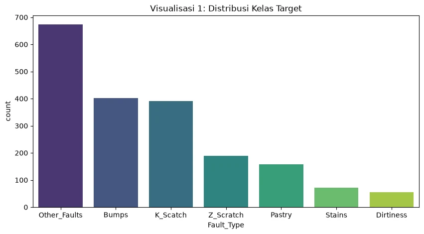
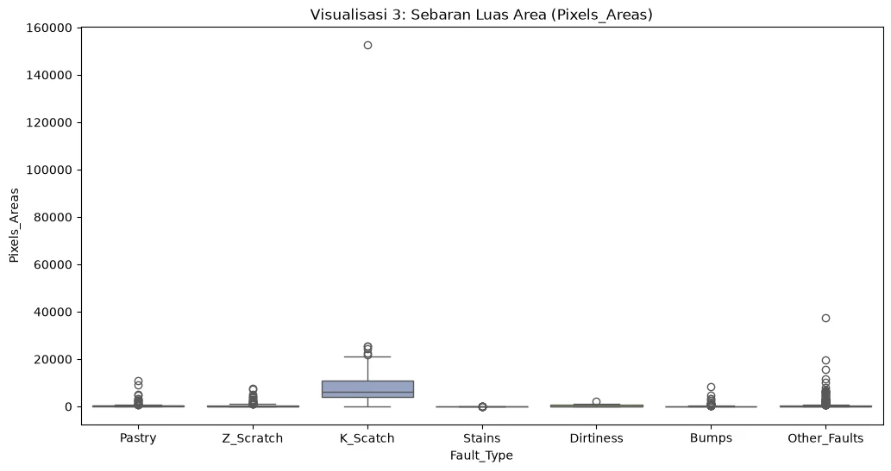

# Klasifikasi Cacat Pelat Baja

Model machine learning untuk menentukan **jenis cacat pada pelat baja** secara otomatis dari 27 fitur fisik hasil pemindaian. Dua algoritma dibandingkan: **K-Nearest Neighbors (KNN)** sebagai model standar dan **Random Forest** sebagai pembanding.

| Model | Akurasi data uji | Macro F1 |
|---|---|---|
| KNN (k = 5) | 72,75% | 0,74 |
| **Random Forest** | **80,21%** | **0,80** |

## Dataset

[`steel_plates_faults_original_dataset.csv`](steel_plates_faults_original_dataset.csv): 1.941 sampel pelat baja.

- **Fitur (27):** posisi cacat (`X_Minimum`, `Y_Maximum`, …), luas dan keliling (`Pixels_Areas`, `X_Perimeter`, …), luminositas, panjang konveyor, tipe baja, ketebalan pelat, serta indeks bentuk (`Edges_Index`, `Square_Index`, `LogOfAreas`, …).
- **Target (7 kelas):** `Bumps`, `Dirtiness`, `K_Scatch`, `Other_Faults`, `Pastry`, `Stains`, `Z_Scratch`.

Di data asli, ketujuh kelas ditulis sebagai 7 kolom terpisah. Kolom-kolom itu digabung menjadi satu kolom target `Fault_Type`, lalu kolom aslinya dihapus agar tidak terjadi kebocoran target.

## Temuan EDA

| Distribusi kelas | Sebaran luas area per kelas |
|---|---|
|  |  |

- **Kelas tidak seimbang.** `Other_Faults` paling banyak, sedangkan `Dirtiness` dan `Stains` sangat sedikit.
- **Dimensi fisik pelat saling berkorelasi kuat**, misalnya luas, keliling, dan luminositas.
- **Banyak outlier** pada `Pixels_Areas`, terutama di kelas `Other_Faults`.

## Alur kerja

1. **Cleaning:** cek nilai kosong dan duplikat (tidak ada), lalu hapus kolom `id` karena tidak punya pola prediktif.
2. **Split:** 80% latih dan 20% uji dengan `stratify` agar proporsi tiap kelas tetap sama.
3. **Scaling:** `StandardScaler` di-*fit* hanya pada data latih, lalu dipakai untuk data uji, supaya tidak ada kebocoran informasi. Langkah ini penting karena KNN sensitif terhadap skala.
4. **Modeling:** KNN (`n_neighbors=5`) dan Random Forest (`random_state=42`).
5. **Evaluasi:** akurasi dan *classification report* (precision, recall, F1 per kelas).

## Hasil

Random Forest unggul sekitar 7,5 poin persentase dibanding KNN. Model ini lebih tahan terhadap outlier dan ketidakseimbangan kelas yang ditemukan saat EDA.

| Kelas | F1 KNN | F1 Random Forest |
|---|---|---|
| Bumps | 0,63 | 0,73 |
| Dirtiness | 0,86 | 0,80 |
| K_Scatch | 0,96 | 0,94 |
| Other_Faults | 0,66 | 0,78 |
| Pastry | 0,44 | 0,56 |
| Stains | 0,80 | 0,89 |
| Z_Scratch | 0,84 | 0,90 |

Kelas `Pastry` masih paling sulit dikenali oleh kedua model, karena datanya sedikit dan polanya mirip kelas lain.

## Menjalankan

```bash
pip install pandas numpy matplotlib seaborn scikit-learn jupyter
jupyter notebook modul1.ipynb
```

Jalankan semua sel dari atas ke bawah. Dataset dibaca dari folder yang sama dengan notebook.

## Struktur

```
modul1.ipynb                              notebook utama: EDA, cleaning, modeling, evaluasi
steel_plates_faults_original_dataset.csv  dataset
docs/                                     gambar untuk README
```

## Penulis

**Deftrian Dwi Wicaksana**, mahasiswa S1 Teknik Komputer, Telkom University
Portofolio: [badakganteng31.github.io](https://badakganteng31.github.io)
